<div align="center">

# AgentSI

**Agent Super Intelligence**

An agency of role agents for your own products.<br>
A PM, a dev, a QA, a scout and a social role read your product, meet and rank what to do next.<br>
You approve every change.

[](https://github.com/matiaslapolla/agentsi/actions/workflows/ci.yml)
[](https://github.com/matiaslapolla/agentsi/actions/workflows/rust.yml)
[](https://github.com/matiaslapolla/agentsi/releases)


[](LICENSE)

<picture>
  <source media="(prefers-color-scheme: light)" srcset="docs/guide/img/desk-conversation-light.png">
  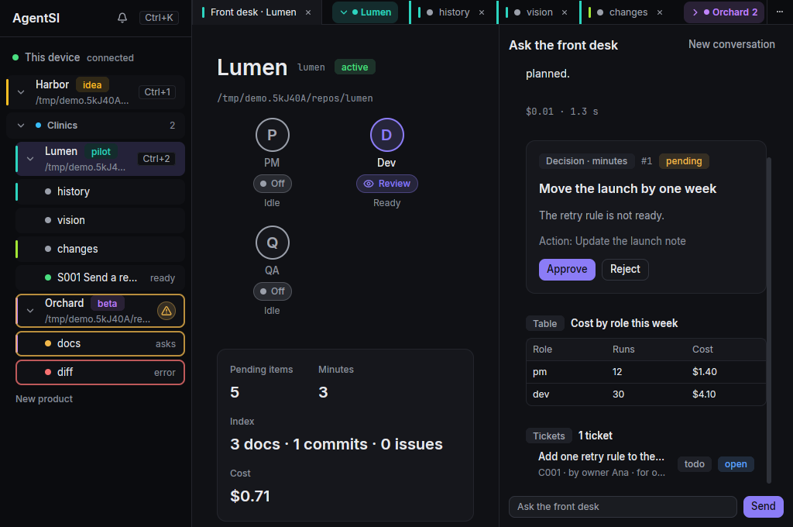
</picture>

<sub>The front desk. You ask Claude about the product, and the answer shows decisions, tables and tickets that you act on.</sub>

[Install](#install-from-a-release-tarball) · [Build](#build-from-source) · [Guide](docs/guide/README.md) · [Roadmap](ROADMAP.md)

</div>

## Why AgentSI

- **You decide.** The roles read and propose. Nothing changes in a product until you approve it.
- **One place for each product.** Terminals, meetings, stories, tickets, git and voice sit in one native Linux app.
- **Voice on your device.** You dictate, and the roles talk back. The speech models run on your machine.
- **It works with Claude Code.** Run `/agentsi` in the repo of a product, and the same front desk opens in your terminal.

## A tour

<table>
  <tr>
    <td width="50%">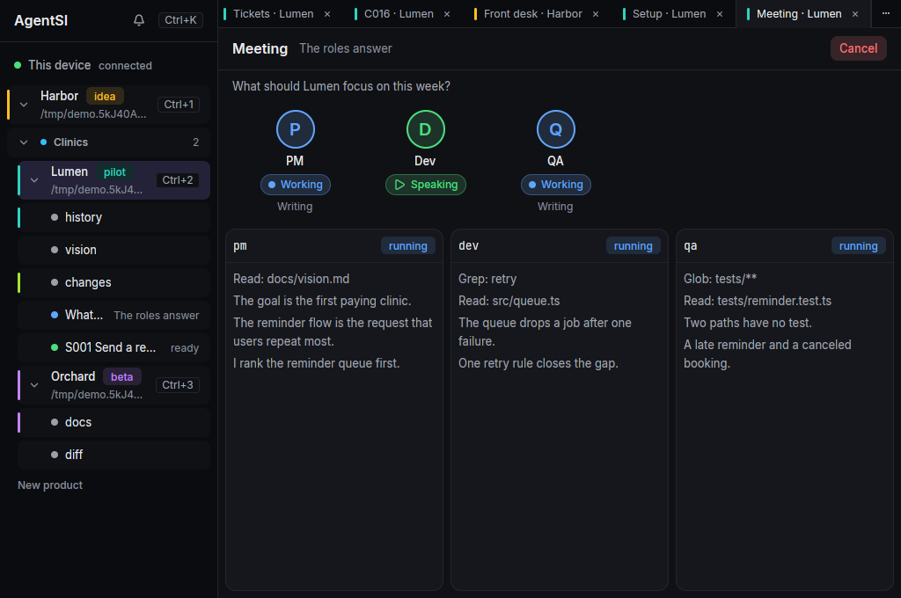</td>
    <td width="50%">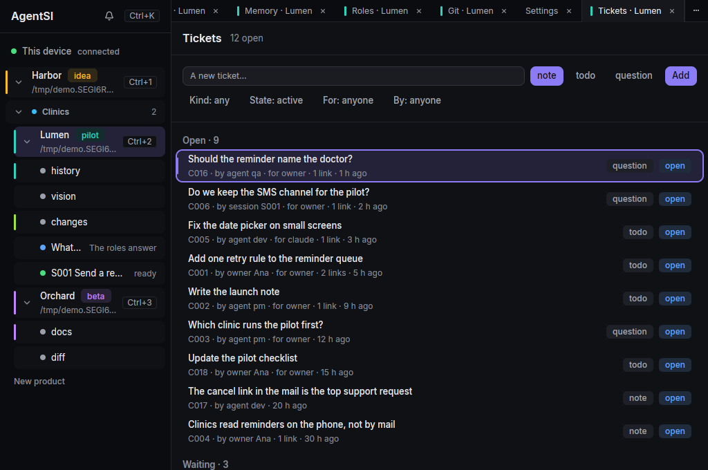</td>
  </tr>
  <tr>
    <td><b>Meetings with agent cards.</b> Each role answers one question. Its card shows when it reads, writes and speaks. The PM writes the minutes.</td>
    <td><b>Tickets.</b> Notes, todos and questions from you, the roles and the story sessions. You promote a ticket to a story.</td>
  </tr>
  <tr>
    <td>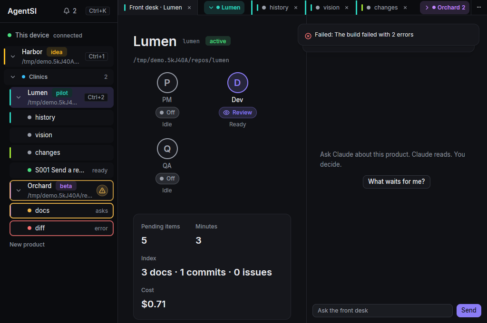</td>
    <td>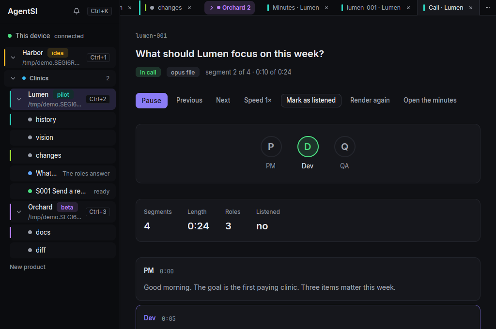</td>
  </tr>
  <tr>
    <td><b>Alerts.</b> A blocked pane or a failed build gets a border in its state color, a toast, a tone and a system notification.</td>
    <td><b>Calls.</b> A meeting plays as audio, with one voice for each role.</td>
  </tr>
  <tr>
    <td>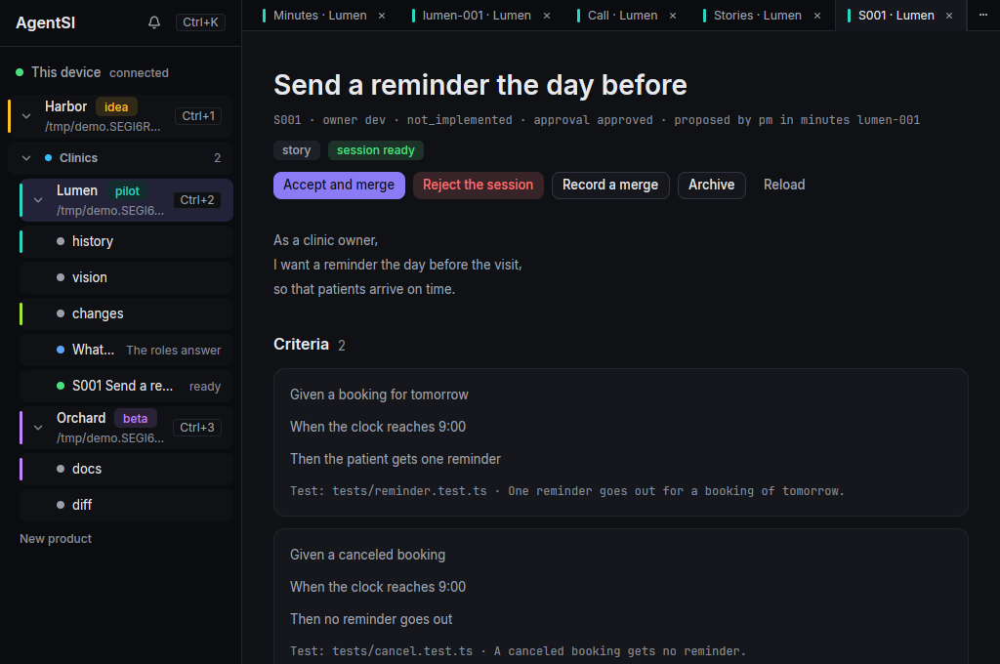</td>
    <td>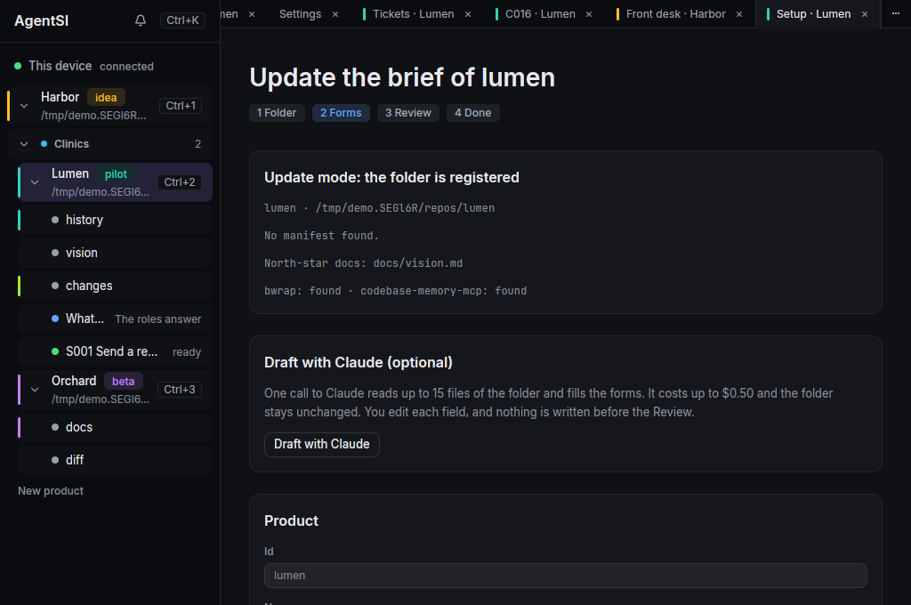</td>
  </tr>
  <tr>
    <td><b>Stories.</b> A story runs in a sandboxed git worktree. You review the diff before anything merges.</td>
    <td><b>Setup.</b> Pick a folder. The app reads its facts, and one optional Claude call drafts the forms. A dry run shows the result before anything saves.</td>
  </tr>
</table>

<details>
<summary><b>More screens</b>: settings, health, light theme, git, palette</summary>
<br>

| | |
|---|---|
| 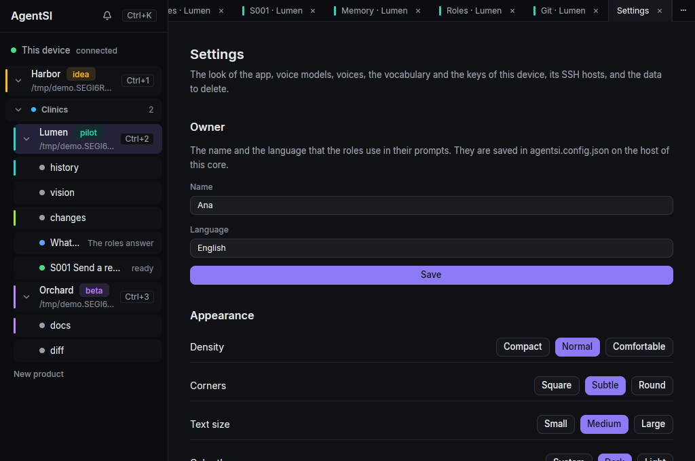 | 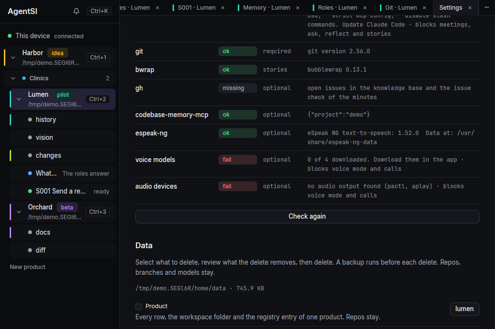 |
| 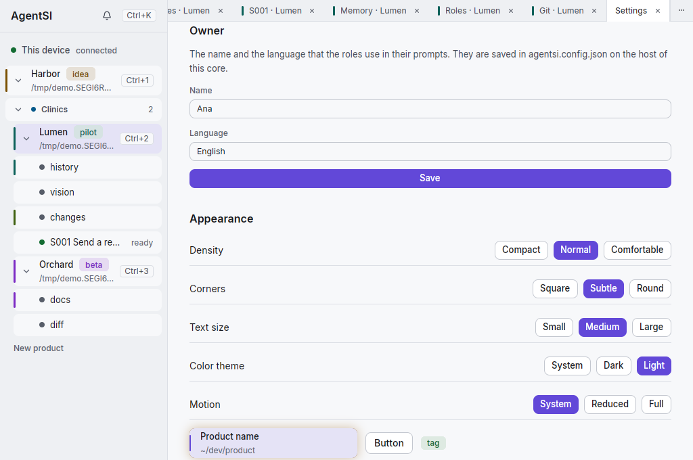 | 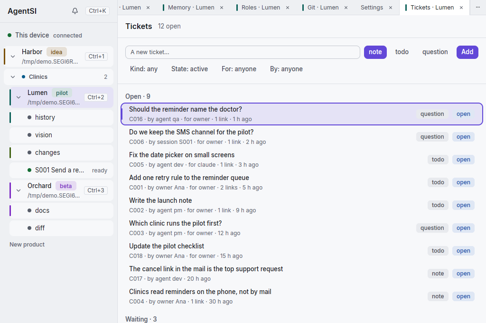 |
| 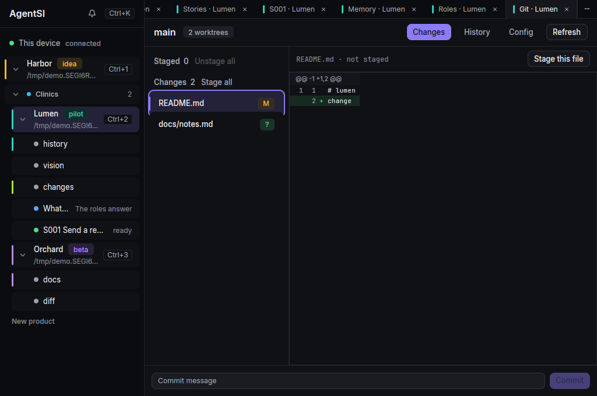 | 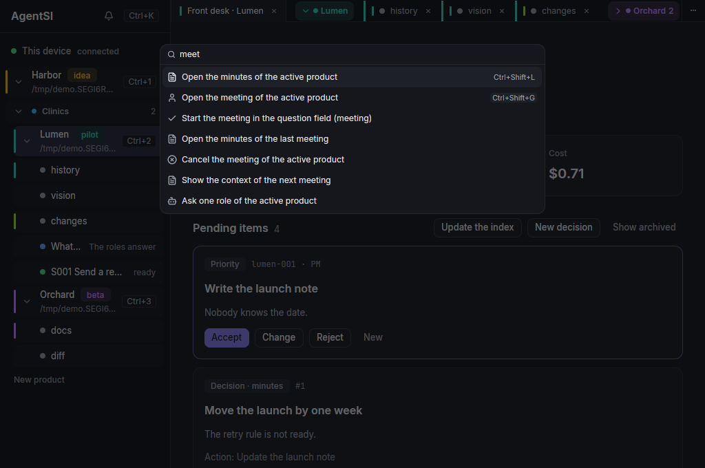 |

</details>

## What exists today

The desktop app:

- A sidebar tree of products, with the panes, meetings, story sessions and reflections of each product.
- Tabs and tab groups, with labels and colors, and product groups in the sidebar.
- A front desk conversation. Claude reads the product, and the answer shows decisions, priorities, stories, diffs, tickets, tables and charts. You approve or reject a decision in place.
- Tickets: notes, todos and questions, with filters. `Ctrl+Shift+I` opens them. You promote a ticket to a story.
- Agent cards on the meeting, call and desk screens. Each card shows the live state of its role.
- Alerts: a border in the state color, toasts, tones, an alert log behind the bell and system notifications.
- A setup screen that creates a product from a folder, with a dry run before it saves.
- Actions that needed a command before: new decisions, marks, archive and restore, reflect, and "Run in Claude".
- Settings: owner, appearance (density, corners, text size, Dark or Light theme, motion), health checks, backups, alerts and "Clear data". "Clear data" makes a backup first.
- A git panel with a git config for each product, and context menus on products, panes, tabs, stories and meetings.

Voice, on your device:

- Dictation into a terminal pane, by holding a key or by toggle.
- Conversation mode: you talk to a Claude Code pane, and the pill speaks the reply.
- The models are Parakeet for speech in, Kokoro for speech out and Silero for the voice detector. They run on your machine.

The agency:

- Meetings in which each role answers one question. The PM writes the minutes, and a call plays the meeting as audio.
- Stories that run in sandboxed git worktrees. You review the diff before anything merges.
- MCP tools for tickets, so a Claude Code session can add and update tickets.
- The Claude Code plugin. Run `/agentsi` in the repo of a product to open the front desk.

## Status

AgentSI is a personal tool, shared as it is. Linux is the only tested platform. macOS comes later.

The repo still holds the old TypeScript web app in `apps/` and `packages/`. The switch-over step removes it.

## The four programs

| Program | What it does |
|---|---|
| `agentsi` | The command line client of the core. |
| `agentsi-core` | The daemon. It holds the data, the meetings, the stories and the terminals. |
| `agentsi-app` | The desktop app. It starts the core when no core runs. |
| `agentsi-pill` | The small voice window. It listens for dictation and conversation mode. |

## Install from a release tarball

Download the tarball and its `.sha256` file from [Releases](https://github.com/matiaslapolla/agentsi/releases). Pick the tarball whose name ends with the output of `uname -m`: `x86_64` or `aarch64`. The tarball holds the built programs. You need no Rust and no build. [`packaging/INSTALL.md`](packaging/INSTALL.md) has the full steps and the fixes for common failures.

1. Install the runtime packages and Claude Code. `packaging/INSTALL.md` lists the packages for Arch and Ubuntu.
2. Unpack the tarball and go into its folder.
3. Run `./install.sh --enable`. It copies the programs to `~/.local/bin` and starts the core and the pill as systemd user services.
4. Add the plugin to Claude Code. Run these commands inside the tarball folder:

   ```sh
   claude plugin marketplace add ./
   claude plugin install agentsi@agentsi
   ```

5. Run `agentsi-app`.
6. Open Settings with `Ctrl+,`. In "Voice models", download the speech-in model, the voice and the voice detector.

## Build from source

You need these tools:

- The Rust toolchain that `rust-toolchain.toml` pins. Install it with `rustup`.
- Zig 0.17.0. The script `scripts/zig.sh` downloads it when the machine has none.
- Docker, only for `make dist-portable`.

On Ubuntu 24.04, install the system packages:

```sh
sudo apt-get install -y build-essential pkg-config clang cmake curl xz-utils \
  libwayland-dev libxkbcommon-dev libxkbcommon-x11-dev libx11-xcb-dev libxcb1-dev \
  libfontconfig-dev libfreetype-dev libasound2-dev libvulkan-dev libssl-dev
```

On Arch, install `base-devel clang cmake wayland libxkbcommon-x11 fontconfig freetype2 alsa-lib vulkan-icd-loader`. At run time, the programs also need `espeak-ng` and `wl-clipboard`.

Then run these commands from the repo:

```sh
make release
make install ENABLE=1
make dist-portable
```

- `make release` builds the four programs in `target/release`. The first build takes several minutes.
- `make install ENABLE=1` copies the programs to `~/.local/bin` and starts the services.
- `make dist-portable` builds in an `ubuntu:24.04` container and packs a tarball in `dist/`. The tarball runs on glibc 2.39 or newer. It has the CPU of the machine that builds it, so an aarch64 machine makes the aarch64 tarball.

`make help` lists all targets. `CONTRIBUTING.md` has the details of the build.

## The guide

The guide of the desktop app is [`docs/guide/README.md`](docs/guide/README.md). The app shows it from the palette entry "Open the guide".

The domain terms are in [`CONTEXT.md`](CONTEXT.md). The voice models and their licenses are in [`VOICES.md`](VOICES.md).

## Links

- [ROADMAP.md](ROADMAP.md): what comes next.
- [CONTRIBUTING.md](CONTRIBUTING.md): how to build, test and send a change.
- [SECURITY.md](SECURITY.md): the threat model and how to report a vulnerability.
- [LICENSE](LICENSE): MIT. The Rust crates declare Apache-2.0 (ADR 0008).

Open source and free forever. Made in Argentina.
