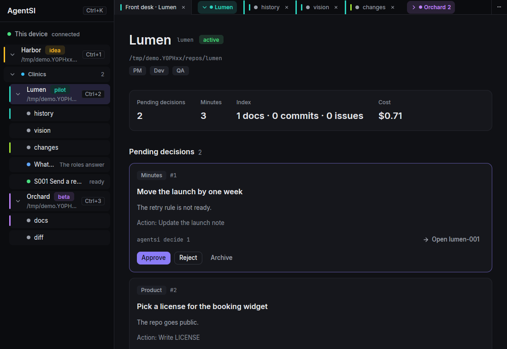

# AgentSI

Agent Super Intelligence

AgentSI is an agency of role agents for your own products. The roles are PM, dev, QA, scout and social. You use the agency from Claude Code and from a native Linux desktop app. The app has terminals, voice, meetings, stories and git.

Nothing changes in a product without your approval. The roles read the product, meet, and give you ranked priorities and decisions to approve.



## What exists today

The desktop app:

- A sidebar tree of products, with the panes, meetings, story sessions and reflections of each product.
- Tabs and tab groups, with labels and colors, and product groups in the sidebar.
- Context menus on products, panes, tabs, stories and meetings.
- A git panel with a git config for each product.
- Appearance settings: density, corners and text size.
- A "Clear data" action in Settings. It makes a backup first.

Voice, on your device:

- Dictation into a terminal pane, by holding a key or by toggle.
- Conversation mode: you talk to a Claude Code pane, and the pill speaks the reply.
- The models are Parakeet for speech in, Kokoro for speech out and Silero for the voice detector. They run on your machine.

The agency:

- Meetings in which each role answers one question. The PM writes the minutes, and a call plays the meeting as audio.
- Stories that run in sandboxed git worktrees. You review the diff before anything merges.
- The Claude Code plugin. Run `/agentsi` in the repo of a product to open the front desk.

## Status

AgentSI is a personal tool, shared as it is. Linux is the only tested platform. macOS comes later.

The repo still holds the old TypeScript web app in `apps/` and `packages/`. The switch-over step removes it.

## The four programs

| Program | What it does |
|---|---|
| `agentsi` | The command line client of the core. |
| `agentsi-core` | The daemon. It holds the data, the meetings, the stories and the terminals. |
| `agentsi-app` | The desktop app. It starts the core when no core runs. |
| `agentsi-pill` | The small voice window. It listens for dictation and conversation mode. |

## Install from a release tarball

Download the tarball and its `.sha256` file from [Releases](https://github.com/matiaslapolla/agentsi/releases). Pick the tarball whose name ends with the output of `uname -m`: `x86_64` or `aarch64`. The tarball holds the built programs. You need no Rust and no build. [`packaging/INSTALL.md`](packaging/INSTALL.md) has the full steps and the fixes for common failures.

1. Install the runtime packages and Claude Code. `packaging/INSTALL.md` lists the packages for Arch and Ubuntu.
2. Unpack the tarball and go into its folder.
3. Run `./install.sh --enable`. It copies the programs to `~/.local/bin` and starts the core and the pill as systemd user services.
4. Add the plugin to Claude Code. Run these commands inside the tarball folder:

   ```sh
   claude plugin marketplace add ./
   claude plugin install agentsi@agentsi
   ```

5. Run `agentsi-app`.
6. Open Settings with `Ctrl+,`. In "Voice models", download the speech-in model, the voice and the voice detector.

## Build from source

You need these tools:

- The Rust toolchain that `rust-toolchain.toml` pins. Install it with `rustup`.
- Zig 0.17.0. The script `scripts/zig.sh` downloads it when the machine has none.
- Docker, only for `make dist-portable`.

On Ubuntu 24.04, install the system packages:

```sh
sudo apt-get install -y build-essential pkg-config clang cmake curl xz-utils \
  libwayland-dev libxkbcommon-dev libxkbcommon-x11-dev libx11-xcb-dev libxcb1-dev \
  libfontconfig-dev libfreetype-dev libasound2-dev libvulkan-dev libssl-dev
```

On Arch, install `base-devel clang cmake wayland libxkbcommon-x11 fontconfig freetype2 alsa-lib vulkan-icd-loader`. At run time, the programs also need `espeak-ng` and `wl-clipboard`.

Then run these commands from the repo:

```sh
make release
make install ENABLE=1
make dist-portable
```

- `make release` builds the four programs in `target/release`. The first build takes several minutes.
- `make install ENABLE=1` copies the programs to `~/.local/bin` and starts the services.
- `make dist-portable` builds in an `ubuntu:24.04` container and packs a tarball in `dist/`. The tarball runs on glibc 2.39 or newer. It has the CPU of the machine that builds it, so an aarch64 machine makes the aarch64 tarball.

`make help` lists all targets. `CONTRIBUTING.md` has the details of the build.

## The guide

The guide of the desktop app is [`docs/guide/README.md`](docs/guide/README.md). The app shows it from the palette entry "Open the guide".

The domain terms are in [`CONTEXT.md`](CONTEXT.md). The voice models and their licenses are in [`VOICES.md`](VOICES.md).

## Links

- [ROADMAP.md](ROADMAP.md): what comes next.
- [CONTRIBUTING.md](CONTRIBUTING.md): how to build, test and send a change.
- [SECURITY.md](SECURITY.md): the threat model and how to report a vulnerability.
- [LICENSE](LICENSE): MIT. The Rust crates declare Apache-2.0 (ADR 0008).

Open source and free forever. Made in Argentina.
