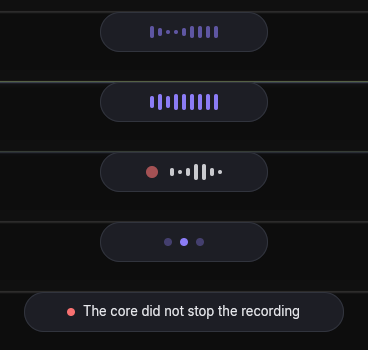

# agentsi-pill

The pill process of the AgentSI desktop app. Spec: `docs/specs/agentsi-desktop-voice.md`.



The pill is a client of the local core. It subscribes to the `voice` and `dictation` topics and draws one small overlay at the top center of the focused output. A click stops the speech or the recording.

## Run

```sh
export CARGO_TARGET_DIR=~/.cache/agentsi-target
cargo run -p agentsi-pill                       # connects to the core, starts it if none runs
cargo run -p agentsi-pill -- --list-devices     # the audio devices
cargo run -p agentsi-pill -- --show speaking --seconds 6   # one phase, no core, stops after 6 s
cargo test -p agentsi-pill
crates/agentsi-pill/linux-criterion.sh           # the Linux criterion of the voice spec (needs Hyprland)
crates/agentsi-pill/linux-criterion.sh --live    # the same criterion while the pill really speaks
crates/agentsi-pill/speech-bench.py              # Stop hook to first sound, and voice.stop to silence
```

`--show <hidden|preparing|speaking|listening|transcribing|error>` draws one phase for 1 to 30 seconds and stops. `--message` sets the error line. `AGENTSI_PILL_STATS=1` prints the time to open each window and, at exit, the number of frames drawn.

The pill needs a Wayland session with `zwlr_layer_shell_v1`. Without `WAYLAND_DISPLAY` and its socket, it prints a reason and exits with code 2. It never falls back to X11, because X11 makes a window that takes focus.

## Phases

| Phase | Window | Draws | Leaves when |
|---|---|---|---|
| hidden | none | nothing | a `voice.speak` event or a set from the speech or speech-in code |
| preparing | 168 × 40 | a slow wave of 9 bars | the first sound plays (`speaking`), a stop, a click, or 10 s (then an error) |
| speaking | 168 × 40 | bars that follow syllables | `voice.stop` of the same terminal, a click, or the last sound played |
| listening | 168 × 40 | a red dot and 7 bars | a click (sends the stop, then `transcribing`) |
| transcribing | 168 × 40 | 3 dots, one lit | the speech-in code sets `hidden`, or 30 s (then an error) |
| error | 320 × 40 | a red dot and one line | 3 s, or a click |

- Hidden has no surface, so it draws 0 frames. `preparing`, `speaking`, `listening` and `transcribing` draw on a 30 Hz timer. `error` draws 3 frames when the window opens (the compositor sends a size and a scale) and none after. Test: `AGENTSI_PILL_STATS=1 agentsi-pill --show error --seconds 4`.
- The rules live in `src/state.rs`, with no window code. Its tests run with no display.
- A `voice.speak` during a recording does nothing. The microphone wins.

## Events and calls

| Direction | Message | Effect |
|---|---|---|
| core to pill | `voice.speak {terminal, role, text}` | phase `preparing`, and `Effect::StartSpeech` |
| core to pill | `voice.stop {terminal}` | phase `hidden` if the terminal is the one that speaks, and `Effect::StopSpeech` |
| core to pill | `dictation.target {terminal?}` | read and ignored for now (U14) |
| core to pill | `core.lagged {missed}` | hides a speech in progress, because events are missing |
| pill to core | `core.hello`, `core.subscribe {topics: [voice, dictation]}` | at each (re)connect |
| pill to core | `voice.dictate {action: "stop"}` | on a click while `listening`, on a second connection |

The link thread starts the core at the first connect if none runs. After a break, the thread retries with a wait of 0.5 s that doubles up to 5 s. A retry never starts the core, because a core that stops later stopped on purpose.

## Audio devices

`cpal` lists the devices of the default host. The pill takes the choice of one input and one output from these sources. A later source replaces an earlier one:

1. `<config>/agentsi/pill.toml`, with the keys `input` and `output`.
2. The variables `AGENTSI_PILL_INPUT` and `AGENTSI_PILL_OUTPUT`.
3. The flags `--input` and `--output`.

A value is an id, an exact name or a part of a name. If two devices match, the pill reports an ambiguous choice. With no value, the pill takes the default device. If a value matches no device, the pill shows an error line at start. U10 chooses the devices and does not open a stream.

## Speech (U12)

`src/speak.rs` holds the speech. The pill loads the voice at start, because that takes about 2 s.

- The voice is Kokoro v1.0 on ONNX Runtime (`agentsi-voice::tts`). It reads the catalog files in `<models>/catalog/kokoro/`. The settings screen downloads them. Until then: `cargo run -p agentsi-voice --example fetch -- kokoro`.
- The phonemes come from the `espeak-ng` program, version 1.52. `AGENTSI_ESPEAK` names another program. Without the program or the model, each reply shows a 3 s error line.
- `voices.toml` gives the voice of each role and `lexicon.toml` the spoken form of words. The file in the data root replaces the default file of `packages/voice/`.
- On `voice.speak`, one thread renders the reply one sentence at a time into a queue, and the output stream plays from the queue. The first sentence plays while the next one renders. Two replies play one after the other.
- On `voice.stop` or a click, the queue empties at once. The stream plays silence from its next buffer, which the pill asks to be 20 ms. The rest of the reply never renders.
- The stream runs at 24 kHz if the device takes it, else at the device rate with a linear resample. It pauses when the queue is empty.
- `Effect::StartSpeech` carries a ticket. The speech code reports `Input::Speech {ticket, event}` with `Playing`, `Done` or `Failed`. A report with an old ticket does nothing, so a late report never shows the pill again after a stop.
- `AGENTSI_PILL_STATS=1` also prints "first sound at <ns>" and "silence at <ns>" (Unix time). `speech-bench.py` reads them.

## For the speech-in code (U14)

- `view::Options::hook` gets each `Effect`. U14 stops the recorder on `StopRecording`. The hook in `main.rs` calls `Speaker::effect` today.
- `Input::Set(Phase)` and `Input::Fail(text)` move the pill. `LinkSender` carries them: `LinkEvent::Input(Input::Set(Phase::Listening))`.
- `agentsi-voice` with the `tts` feature already links ONNX Runtime through `ort`. Use the same `ort` entry of the workspace.

## macOS (M2)

`WindowKind::PopUp` makes a nonactivating panel. `main.rs` has a stub that exits with code 2 on other systems.
