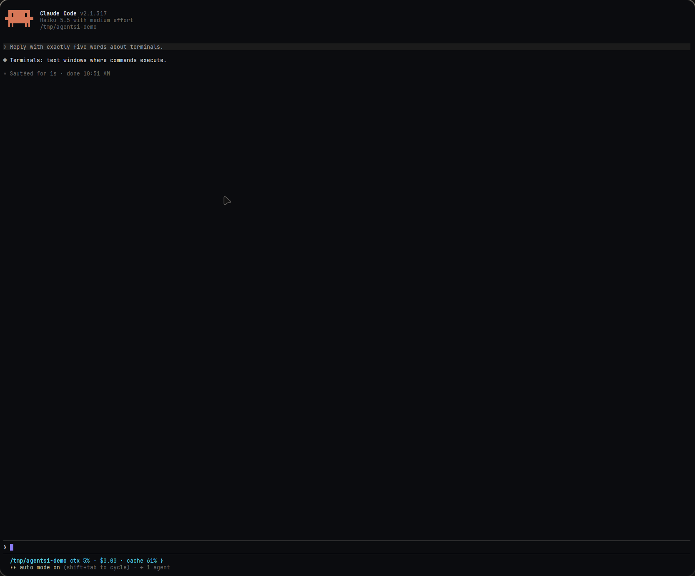

# agentsi-term-view

The terminal pane of the AgentSI app. A GPUI view that keeps one libghostty-vt screen, draws its cells and turns keys, the mouse, pastes and focus into bytes for the program. The pane knows no PTY and no core: bytes go in through `feed`, and bytes come out as events.



`screens/` holds bash (`bash.png`), the shapes (`shapes.png`, 2×), btop (`btop.png`, with the process list blacked out) and Claude Code (`claude-spinner.png`, `claude-answer.png`, with the plan name blacked out).

## Run

```sh
cargo run -p agentsi-term-view --example pane --release              # $SHELL
cargo run -p agentsi-term-view --example pane --release -- -- btop
cargo run -p agentsi-term-view --example pane --release -- -- claude --model haiku
cargo run -p agentsi-term-view --example pane --release -- --bench terminal --seconds 10 --json
cargo run -p agentsi-term-view --example pane --release -- --bench idle --seconds 10 --json
cargo test -p agentsi-term-view
```

The example runs the program on a local PTY with `agentsi-pty`. Its other flags (`--size`, `--script`, `--exit-after`, `--dump`) are in the header of `examples/pane.rs`. `bench/terminal.sh` is the writer of the terminal bench.

## Interface

```rust
let pane = cx.new(|cx| TerminalPane::new(PaneOptions::default(), window, cx));
cx.subscribe(&pane, |pane, event, cx| match event {
    PaneEvent::Output(PaneOutput::Input(bytes)) => { /* typed keys, pastes, mouse reports */ }
    PaneEvent::Output(PaneOutput::Auto(bytes)) => { /* replies of the pane's screen */ }
    PaneEvent::Output(PaneOutput::Resize { cols, rows }) => { /* the pane has a new size */ }
    PaneEvent::Output(PaneOutput::Focus(focused)) => { /* the pane gained or lost focus */ }
    PaneEvent::Title(title) => {}
    PaneEvent::Bell => {}
}).detach();
pane.update(cx, |p, cx| p.feed(&bytes, read_at, cx));
```

- `feed(bytes, read_at, cx)` takes the bytes of the program. `read_at` is the time of the read. With a bench in `PaneOptions`, the pane records the time from `read_at` to the paint.
- The four `PaneOutput` kinds match the frames DATA, AUTO, RESIZE and FOCUS of `docs/specs/agentsi-desktop-protocol.md`.
- `focus_report(focused)` gives `CSI I` or `CSI O` when the program set mode 1004. Only a host without a core writes it. The core writes its own from its screen.
- `text_lines()` gives the visible text, for tests and dumps. `grid_size()` gives the size in cells.
- The pane implements `Focusable`. A click focuses it.

## Input

| Input | Program asked for the mouse | Else |
|---|---|---|
| Keys | libghostty-vt key encoder, with the modes of the program | same |
| Left drag | mouse reports, also for a drag and a release outside the pane | selection: 1 click cells, 2 words, 3 lines |
| Middle click | mouse report | paste of the primary selection |
| Wheel | wheel reports | scrollback, or arrow keys on the alternate screen with mode 1007 |
| `Shift` + mouse | the pane's own selection and scrollback | same |

- `Ctrl+Shift+C` copies the selection. `Ctrl+Shift+V` pastes, bracketed when the program set mode 2004. A finished selection also goes to the primary selection.
- `Shift+PageUp`, `Shift+PageDown`, `Shift+Home` and `Shift+End` move the viewport. A key that makes bytes moves the viewport back to the live screen.

## Drawing

- Background runs are quads. Text runs are shaped lines with a forced advance of one cell (two for a wide character).
- Block elements (U+2580 to U+259F), box drawing (U+2500 to U+257F) and braille (U+2800 to U+28FF) are shapes from `src/shapes.rs`: quads for lines and blocks, paths for the rounded corners and the diagonals.
- Colors, the font, the row height, the padding and the cursor bar come from `agentsi_ui::tokens`. The pane sets the token palette on its screen.
- The pane has three views. The root takes input. The cells view is cached and draws again only after new bytes, a scroll or a selection change. The cursor view draws the cursor, so a blink frame does not draw the cells.
- The pane keeps the draw lists and the shaped lines of each row (`FrameCache` in `src/frame.rs`). After new bytes, it reads again only the rows that libghostty-vt marks dirty. It builds again only the rows whose cells or selection changed. A row that moved, as in a scroll, keeps its lists, because each row has an id that moves with it. New default colors build every row again.
- The pane makes the path of a shape (a rounded corner or a diagonal) once for each character and cell size, and moves a copy to each cell.
- The cursor blinks only when the program asks for a blinking cursor and the pane has focus. It stops after `motion::CARET_IDLE` with no typing. Output does not restart it. Without focus the cursor is a hollow block.
- While the program holds a synchronized update (mode 2026), the pane waits for its end, at most 1 s.

## Traps

1. **Two screens.** In the app the core also keeps a screen and answers the queries. The core removes the queries that it answered from the stream, so the pane's screen does not answer them again. `PaneOutput::Auto` carries what the pane's screen still answers.
2. **Size.** The pane takes its size from its own bounds, after layout. The first `Resize` comes after the first frame, also when the size is 80 × 24. Until then the screen is 80 × 24.
3. **Key bindings.** The pane stops the propagation of each key down event. App shortcuts must be actions with key bindings, or the pane takes their keys.
4. **Selection.** The selection keeps absolute rows. Copy takes the rows in view only, and a soft-wrapped line copies as two lines. When the scrollback is full, the library drops old rows, and a selection can move off its text.
5. **Text input.** The pane reads `key_char` of each keystroke. It has no IME input handler yet, so composed text from an input method does not arrive.
6. **Synchronized output.** The pane sees a hold of mode 2026 only at the end of each read. When one read ends a hold and starts the next, the pane draws the start of the next frame. The library's render-hold callback would give the exact frame.
7. **Return after text.** Claude Code 2.1.317 takes a Return that comes 30 ms after the text as a new line in the prompt. In U11, a Return 30 ms after the text submitted 3 of 5 times, and 60 ms submitted 5 of 5. The core now writes the Return 100 ms after the text, as a margin for a loaded machine (`docs/specs/agentsi-desktop.md`). A host without a core must wait as long. The U11 runs were at a load of 68 to 184. A run on a quiet machine would show whether 30 ms also fails there.
