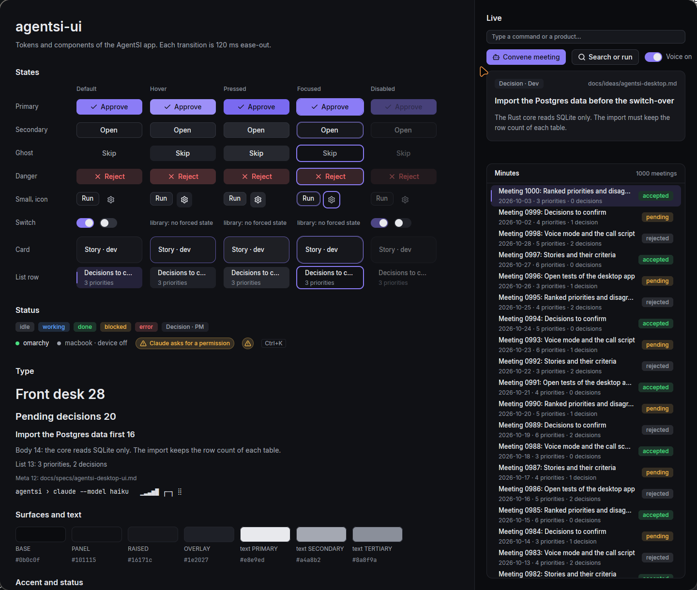

# agentsi-ui

The design system of the AgentSI app: tokens, the theme of `gpui-component`, components and the bench mode. Spec: `docs/specs/agentsi-desktop-ui.md`.



## Run

```sh
export CARGO_TARGET_DIR=~/.cache/agentsi-target
cargo run -p agentsi-ui --example gallery --release
cargo run -p agentsi-ui --example gallery --release -- --bench idle --seconds 10 --json
cargo test -p agentsi-ui
```

`AGENTSI_LIFETIME=<s>` closes the gallery after that many seconds. `examples/frame_probe.rs` is the minimal window of the U2 gate. It prints the frames of each second.

## Use

1. In `Application::run`, call `agentsi_ui::init(cx)`. It initializes `gpui-component`, loads the bundled fonts and sets the theme.
2. Take each color, size, space, radius and duration from `agentsi_ui::tokens`.
3. Take the components from `agentsi_ui::components`. It holds the own components and re-exports the parts of `gpui-component` that the design uses.

A screen never writes `rgb(…)`, `hsla(…)` or `px(…)`. A token color goes straight into `bg`, `text_color` and `border_color`. `style::StyleExt::pad_x` takes the place of `px`. If a screen needs a new value, add a token here.

## Tokens

`src/tokens.rs` holds each token. The test `each_text_and_fill_pair_reaches_4_5_to_1` checks each text color on each fill where the components draw it. If you add a color, add its pairs to `text_pairs`.

| Group | Values |
|---|---|
| Surfaces | `BASE` `#0b0c0f`, `PANEL` `#101115`, `RAISED` `#16171c`, `OVERLAY` `#1e2027`. A pressed fill is `state::pressed(fill)`: the fill with a 4 % light layer |
| Text | `PRIMARY` `#e8e9ed`, `SECONDARY` `#a4a8b2`, `TERTIARY` `#8a8f9a` |
| Accent | `BASE` `#8b7cf6`, `HOVER` `#9d90f8`, `PRESSED` `#7a6af0`, `SUBTLE` (16 % over `PANEL`) |
| Status | `OK` `#4ade80`, `WARN` `#f2b84b`, `DANGER` `#f87171`, `INFO` `#60a5fa`, `OFF` `#9a9faa`, each with a 14 % tint |
| Type | Inter for the UI, JetBrains Mono for terminals and ids. Sizes 12, 13, 14, 16, 20 and 28 px |
| Space and radius | `space(n)` is `4 × n` px. Radius 6, 8 and 12 px |
| Motion | Hover and press 120 ms, panels 180 ms, dialogs 260 ms, all ease-out |

`tokens::terminal` holds the colors of a terminal pane, with the 16 ANSI colors, and its row height, padding, cursor bar and faint text opacity.

## Components

| Component | From | Notes |
|---|---|---|
| `Button` | own | Primary, secondary, ghost and danger. Sizes `Sm` and `Md`. A button with only an icon is a ghost `Button` with `icon(…)` |
| `Card` | own | With a click handler, it takes focus and the border moves to the accent on hover. Without one, it takes no input |
| `ListRow` | own | 44 px. No focus handle: the list takes focus and sets `focused` on the row of its cursor. The trailing element is at most 160 px wide |
| `StatusDot`, `AttentionMarker` | own | Show state. No input. Long text ends with an ellipsis |
| `Tag` (`status_tag`, `neutral_tag`) | `gpui-component` | Status color on its tint, 20 px high, with an ellipsis |
| `Kbd` | `gpui-component` | Takes a `Keystroke` |
| `Switch` | `gpui-component` | The thumb moves on a spring. The switch has no hover or press style |

The own components move their colors with `gpui_kit::base::motion::transition`, 120 ms ease-out. GPUI turns Enter and Space on a focused element with a click handler into a click, so a component adds no key listener.

`Button`, `Card` and `ListRow` accept `force(Force::Hover)` and the other states, so that the gallery shows each state without input.

## Rules for an idle window

The bench measures 0 frames per second on an idle window. These rules keep it at 0:

- Do not use a repeating `with_animation`. It draws each frame at the full refresh rate (100 frames per second on the dev machine). A caret or a pulse uses a timer that toggles a value and calls `notify`.
- `gpui_kit::base::motion::transition` asks for a frame only while it moves. Use it for each transition.
- The theme sets a 530 ms caret blink that stops after 5 s with no typing.

## Rules for a smooth scroll

- Put each list that scrolls in its own view. Put the other areas of the screen in views with `Entity::cached`. Then a scroll frame renders only the list.
- Do not give each row of a list a focus handle. In the gallery, one focus handle in each row cost 3 ms of CPU in each frame of a scroll.

## Bench mode

`src/bench.rs` reads `--bench <idle|scroll|terminal|start|attention> --seconds <n> --json`. A view puts `Bench::marker()` in its root and calls `Bench::start` in its context. A bad value exits with code 2 and the usage text.

- `--unfocused`: the window must stay without focus. Use it to measure the throttle of a window without focus.
- `--bench start --runs 10`: the program starts itself 10 times as new processes and reports the p95 time from each start to its first paint.

- The marker records the time of each paint, and each pointer, wheel and key event.
- The bench also records each change of window focus. A run with input reports `"valid": false` and `"pass": null`.
- On Hyprland with `follow_mouse = 1`, a pointer that crosses the window gives it focus. Thus do not move the pointer during a bench.
- The terminal pane records each PTY-to-paint time with `Bench::record_latency`. Only the samples after the warm-up count.
- `--bench attention`: the attention marker of the app records the time from a scripted `blocked` state to its paint. The pass line needs 20 samples and a p95 of 100 ms or less.

## Fonts

`fonts/` holds Inter 4.1 (Regular, Medium, SemiBold) and JetBrains Mono 2.304 (Regular, Bold). Both use the SIL Open Font License 1.1. The license texts are `fonts/OFL-Inter.txt` and `fonts/OFL-JetBrainsMono.txt`.
