# An agency of roles for each of your products

*AgentSI · Guide to the desktop app*

A PM, a dev, a QA, a scout and a social role read your product. They meet and give you ranked priorities and decisions. You approve each change.

**Contents**

- [What AgentSI is](#what-agentsi-is)
- [Install and start](#install-and-start)
- [The window](#the-window)
- [Products](#products)
- [Meetings](#meetings)
- [Decisions and priorities](#decisions-and-priorities)
- [Stories](#stories)
- [Roles learn](#roles-learn)
- [Voice](#voice)
- [Keys](#keys)
- [Data](#data)
- [The CLI and the Claude Code plugin](#the-cli-and-the-claude-code-plugin)

## What AgentSI is

AgentSI is an agency of role agents. You open it inside your own products, from the desktop app or from Claude Code.

The roles read the product and meet. Their minutes hold priorities with sources, the points where the roles disagree, and decisions that wait for you.

- **The roles advise. You decide.** A role proposes priorities and decisions. Nothing changes in a product without your approval.
- **AgentSI reads your repo.** The index and the roles only read. A story session writes in its own branch. The branch reaches main when you accept it.
- **The data stays on your machine.** The minutes, the memory and the stories live in one SQLite file in the data root. AgentSI makes a backup each day.

### The pieces

The app is the window you work in. The core is a background program that owns the data, the terminals and the meetings.

The pill is a small overlay that listens and speaks. The Claude Code plugin gives Claude Code the front desk, the roles and the `agentsi` command.

Each part connects like this:

- You work in the app (`agentsi-app`) or in Claude Code with the plugin (`/agentsi`, the MCP server and the hooks).
- The app and the `agentsi` command call the core (`agentsi-core`) with JSON-RPC. The plugin runs the `agentsi` command.
- The pill (`agentsi-pill`) calls the core for voice.
- The core reads and writes the SQLite store (`agentsi.db`).
- The core runs each role with `claude -p`. The roles read your repo and never write in it.

*The pieces. You use the app or Claude Code. Both talk to the core. The core keeps the data in the SQLite store and runs each role with `claude -p`.*

> **Costs.** AgentSI runs your own Claude Code with your own account. These actions call a model and cost money: a meeting, `ask`, `reflect` and a story. The app says so before it starts one.
>
> A meeting calls `claude -p` once for each agent, and one or two times for the synthesis. Each story session has a cap of USD 5.

## Install and start

Linux is the only tested platform. Story sessions need Linux, because they use bubblewrap.

### What you need

| Tool | Needed for |
|---|---|
| Claude Code, logged in | meetings, `ask`, `reflect` and stories |
| git, with `user.name` and `user.email` | stories and the knowledge base |
| `bwrap` | story sessions |
| `espeak-ng` | voice mode and calls (optional) |
| `gh` | open issues in the knowledge base (optional) |

### Steps

1. Build the programs. Follow [CONTRIBUTING.md](../../CONTRIBUTING.md) for the system packages, Rust and Zig. Then run `cargo build --release`.
2. Install them: `packaging/install.sh --enable`.
3. Choose a data root. Write its path in `~/.config/agentsi/home`, or set `AGENTSI_HOME`.
4. Write your products in `agentsi.config.json` in the data root. See [Products](#products).
5. Run `agentsi doctor`. It checks each tool and names the feature that a missing tool blocks.
6. Run `agentsi-app`. The window opens.

```sh
cargo build --release
packaging/install.sh --enable
agentsi doctor
agentsi-app
```

The install script changes nothing outside your home folder. Run it with `--dry-run` to see each step first.

- It copies `agentsi`, `agentsi-core`, `agentsi-app` and `agentsi-pill` to `~/.local/bin`.
- On Linux, it writes the systemd user units `agentsi-core.service` and `agentsi-pill.service`.
- With `--enable`, it starts the core service, and the pill service when the pill is installed.
- On macOS, it writes a launchd agent for the core.

If you build into another folder, pass it with `--from <dir>`. The app starts the core by itself when no core runs.

### The Claude Code plugin

The plugin gives Claude Code the `/agentsi` front desk. Install it from your checkout:

```sh
claude plugin marketplace add /path/to/agentsi
claude plugin install agentsi@agentsi
```

The plugin runs the `agentsi` command, so `agentsi` must be on the `PATH` of Claude Code.

## The window

The window has a sidebar on the left and a dock on the right. The dock holds tabs. A tab is a terminal or a screen.

### The sidebar tree

The sidebar lists your products, grouped by host. A host that does not answer shows "device off".

Each product opens like a folder. Under it you see what runs or stays open:

- each terminal pane of the product, with its status dot,
- each running meeting, with its phase,
- each story session that is not done, with its state,
- a running reflection.

A click on a row focuses its tab, or opens the tab. A closed product shows a count of its running items. The tree stays open or closed after a restart.

You give a label and a color to a product, a pane or a tab. You put products into named groups. The look file `look.toml` in the config folder keeps them.


*The sidebar tree. A product shows its terminals, its meeting and its story sessions.*

### Tabs

- Drag a tab to a new place in its tab bar, to another bar, or to a screen edge to split the dock.
- Drop a tab on a tab group chip to add it to the group. A group collapses to one chip.
- When you close a terminal tab, the terminal stops. When you close the window, the core and its terminals keep running.

### Context menus

A right-click on an object opens a menu with its actions. Each action also has a palette entry.

| Object | Some of its actions |
|---|---|
| Product | New terminal, Open desk, Start meeting, New story, Reflect, Label and color, Move to group, Archive |
| Pane or tab | Rename, Color, Add to tab group, Talk to this pane, Voice mode, Split right, Split down, Close others |
| Story session | Open, Review, Accept, Reject, Open a terminal in the worktree |
| Meeting | Open, Cancel |

### The command palette

Press `Ctrl+K`. The palette lists every action of the app. Type a few letters and press `Enter`. The palette shows the key of each action.

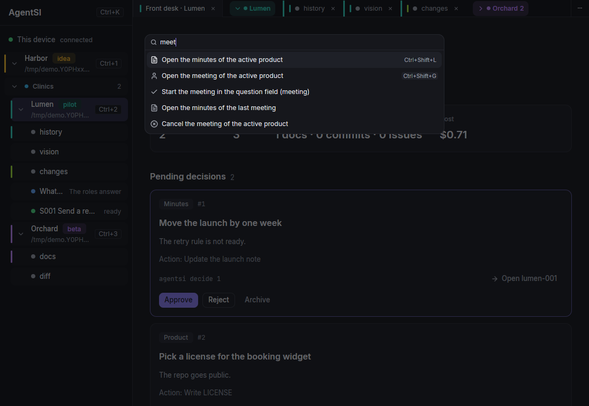

*The command palette. It finds each action by its name or its key words.*

### The screens

| Screen | Key | What it shows |
|---|---|---|
| Front desk | `Ctrl+Shift+D` | State of the product, pending items, last minutes |
| Minutes | `Ctrl+Shift+L` | The list of minutes, and one minutes |
| Meeting | `Ctrl+Shift+G` | A live meeting, one pane for each role |
| Call | `Ctrl+Shift+P` | The player of a meeting call |
| Stories | `Ctrl+Shift+S` | The stories of the product and their review |
| Memory | `Ctrl+Shift+Y` | What each agent learned, and the reflections |
| Roles | `Ctrl+Shift+R` | The roster, the overlays and the specialists |
| Git | `Ctrl+Shift+B` | Branch, changed files and diff. You stage files and commit here |
| Setup | Palette: "Set up a new product" | Register a product or update its brief |
| Settings | `Ctrl+,` | Look, voice, keys, hosts, guide, health of the tools, backup and data |

Other keys: `Ctrl+T` opens a terminal in the active product. `Ctrl+Shift+T` opens `claude`. `Ctrl+1` to `Ctrl+9` select a product. On macOS, `Cmd` takes the place of `Ctrl`.

The app binds no key that a terminal program needs, such as `Ctrl+C` or `Ctrl+W`. The exceptions are `Ctrl+K` and `Ctrl+T`.

### Settings and the look

The Settings screen has a section "Appearance". It has three choices, and each applies at once:

- Density: Compact, Normal or Comfortable.
- Corners: Square, Subtle or Round.
- Text size: Small, Medium or Large. A terminal pane keeps its own font size.

The Settings screen has a section "Owner" with your name and language. It also has the voice models, the vocabulary, the keys, the SSH hosts, the Git config, the Health section and the Data section. The line "Guide" opens this page.

The Health section shows one row for each check of `agentsi doctor`: the tool, its status and what a failed check blocks. "Check again" runs the checks again. In the Data section, "Back up now" copies the database and the registry into the backups folder, and shows the paths of both copies.

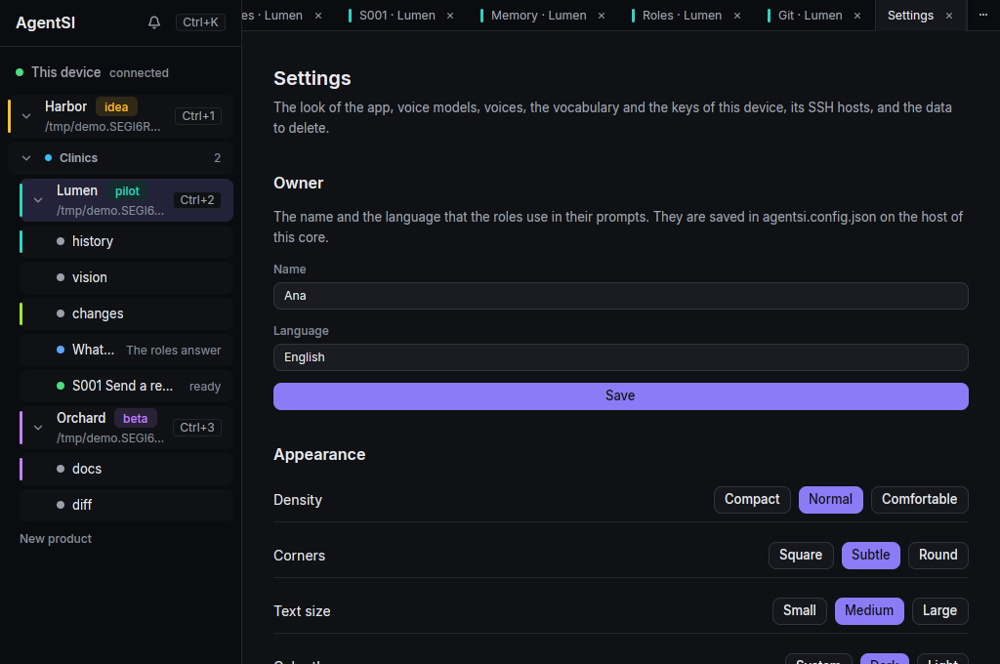

*The Settings screen. The section "Appearance" comes first.*

### The Git screen

The Git screen shows the branch and the changed files of one product. You select a file to see its diff. You stage files and commit. The screen has no push, pull or fetch. You run those in a terminal.

The section "Git" of the Settings screen sets the git config for all products. A product overrides a key on its own Git screen. AgentSI never changes `.git/config` or `~/.gitconfig`.

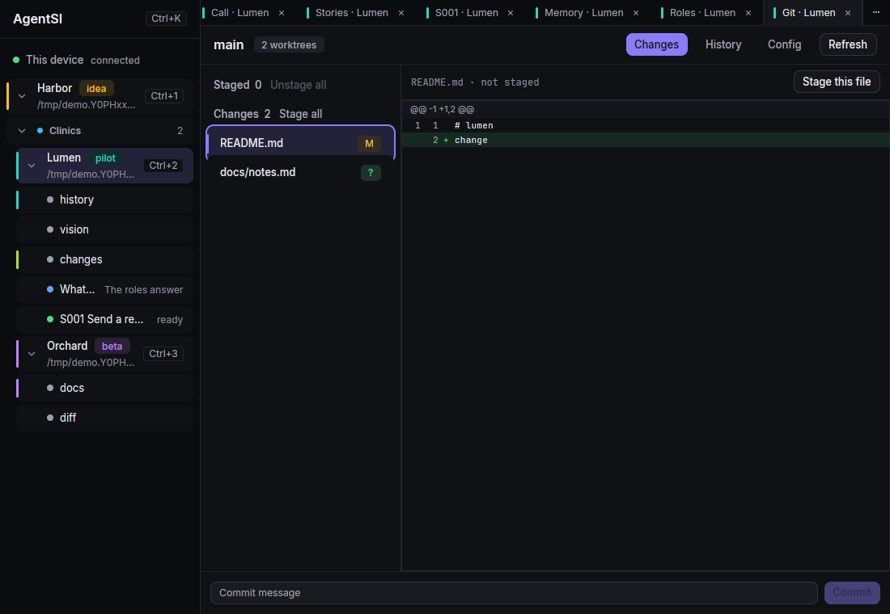

*The Git screen of a product.*

## Products

A product is one front that you run: a web app, a mobile app, a landing page or AgentSI itself. AgentSI knows a product by its paths in the registry.

### The registry

The registry is the file `agentsi.config.json` in the data root. It names the owner, the products and the roles that attend each meeting.

```json
{
  "owner": { "name": "Ana", "language": "English" },
  "products": [
    {
      "id": "myapp",
      "name": "MyApp",
      "paths": ["/home/ana/dev/myapp"],
      "status": "active",
      "roles": ["pm", "dev", "qa", "scout"]
    }
  ]
}
```

- `owner.language` is the language of the prompts and the minutes. The default is English.
- `paths` are absolute paths of the repos of the product.
- The optional `stories` block turns on Stories mode. See [Stories](#stories).

The file `agentsi.config.example.json` in the checkout is a full example. Keep the registry private. Do not put the data root in a shared or synced folder.

### Find the product of a folder

Run `agentsi whoami` in any folder. It prints the product that owns the folder. Run `agentsi whoami --list` to list all products.

### Add a product

In the app:

1. Click "New product" at the end of the product list. The Setup screen opens.
2. Type the absolute path of the repo, or click "Browse…". Click "Read the folder".
3. Optional: click "Draft with Claude". The button shows the cap of 0.50 USD. Click it again to confirm. Claude reads up to 15 files and fills the forms.
4. Check the five forms: Product, Objectives, Roster, Models and Stories mode. A field with the mark "no data" is empty because the files do not answer it.
5. Click "Review". The screen shows the plan. Nothing is written yet.
6. Click "Confirm". The app registers the product, writes the brief and the roster, and opens the front desk.

The Setup screen writes nothing into your repo. In the Claude Code plugin, `/agentsi setup` does the same by interview.

To change a product later, open the product menu and click "Update the brief". You can also edit the owner name and language in the section "Owner" of the Settings.

You can also add the product by hand:

1. Add the product to `agentsi.config.json`.
2. Run `agentsi whoami` in its repo to check the match.
3. Open Claude Code in the repo and run `/agentsi setup`. The PM interviews you and writes the brief and the roster.

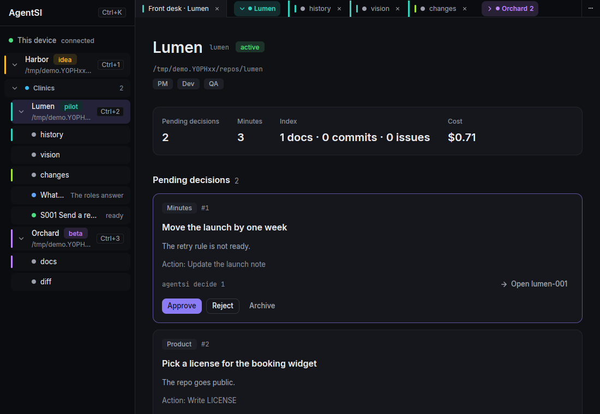

*The front desk of a product. It shows the state, the pending decisions and the last minutes.*

### What AgentSI touches in your repo

The index reads the docs, the journal, the git log of 90 days and the open issues. It stores their text in the SQLite file, outside your repo.

With Stories mode, a story session works in `.worktrees/`, in the branch `story/<id>`. A sandbox with no network isolates it. The branch reaches main when you run `agentsi story accept`.

The minutes and the memory never enter your repo.

What AgentSI reads and writes in your repo:

- The index reads the docs (`README` and `docs/**/*.md`), the journal (`.claude/JOURNAL.md`), the history (`git log`, 90 days) and the open GitHub issues (`gh`). It stores their text in the knowledge base, a SQLite file outside your repo.
- The roles read the repo with the tools Read, Grep and Glob.
- A story session runs in `bwrap` with no network. It commits to the branch `story/<id>` in `.worktrees/`.
- The branch reaches `main` when you accept it.

*What AgentSI reads and writes in your repo.*

## Meetings

In a meeting, the PM asks each agent of the roster one question. Each agent answers once, with sources. The PM writes the minutes.

### Start a meeting

Use any of these three ways:

- In the app, open the Meeting screen with `Ctrl+Shift+G`. Write the question and press "Start the meeting".
- In a terminal, run `agentsi meet --question "What should we focus on this week?"` in the product repo.
- In Claude Code, run `/agentsi` and ask for a meeting.

Before you start, the Meeting screen has one check box for each agent of the roster. The PM stays on, because it writes the synthesis. "Ask one role" sends one question to one role. It asks one Confirm, because it costs money, and shows the answer in a panel. "Show the context" shows the Markdown that the next meeting reads.

The Meeting screen shows one pane for each role and one for the synthesis. A pane shows the state, the seconds, the cost and the text of the run. You can cancel a meeting while it runs.

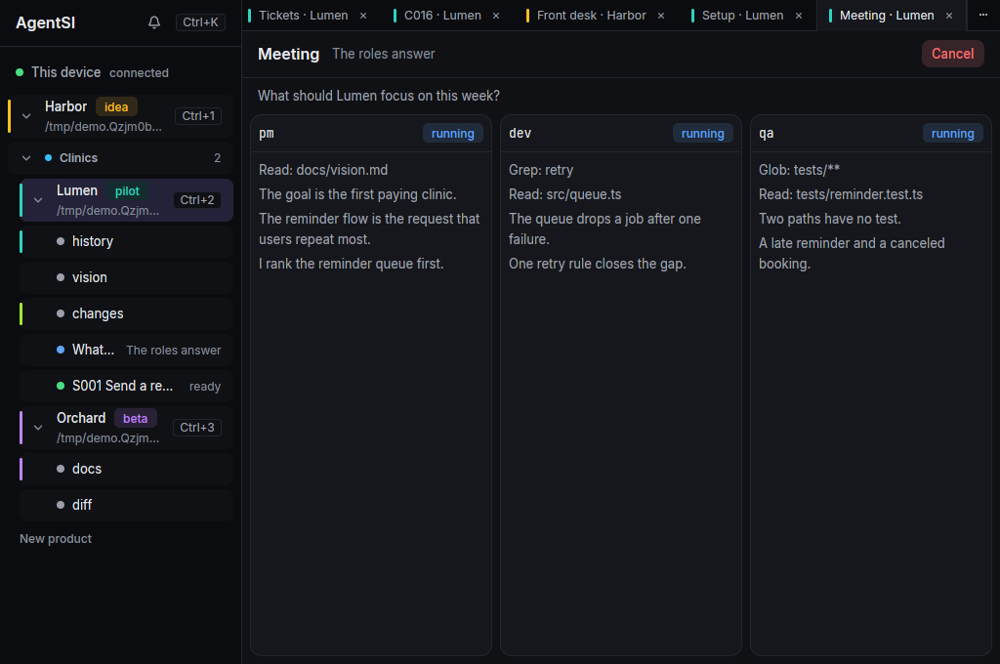

*A meeting in progress. Each role answers in its own pane.*

The steps of a meeting:

1. You ask a question, for example with `agentsi meet`.
2. AgentSI makes a snapshot: the index and the context.
3. Dev, QA, Social and Scout answer in parallel.
4. The PM writes the synthesis.
5. A check in code validates the minutes. If the check fails, the PM repairs the minutes once.
6. AgentSI stores the minutes.

After step 6, you mark the priorities and decide. With `--audio`, AgentSI also renders the call.

*The steps of a meeting. If the check fails, the PM repairs the minutes once.*

### Read the minutes

Open the Minutes screen with `Ctrl+Shift+L`. Each row shows the question, the id, the date, the marks and the status. Press `Enter` or click to open one minutes.

One minutes has five tabs: Priorities, Disagreements, Decisions, Roles and Usage. The header shows the check result and the cost.

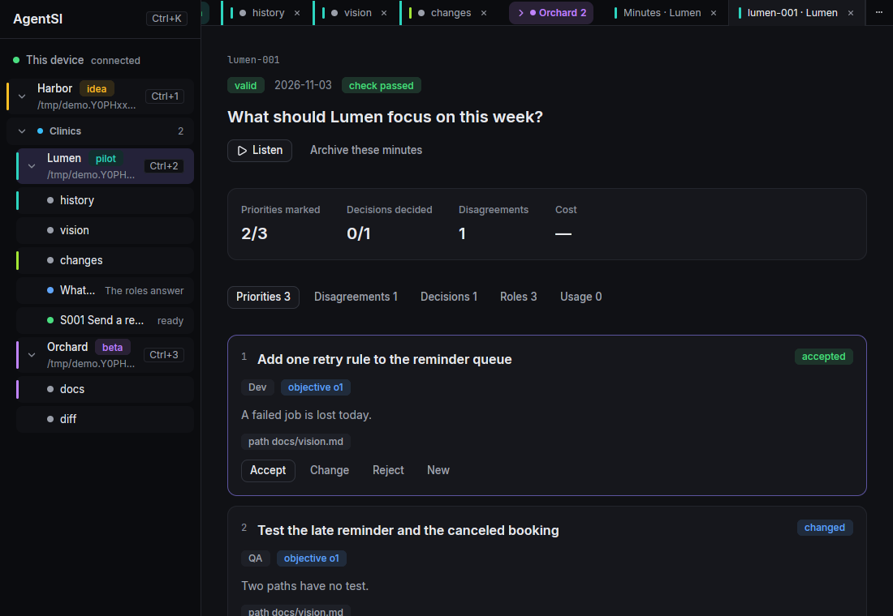

*One minutes. The buttons "Listen" and "Archive these minutes" sit under the question.*

### Listen to the call

A call is the audio of a meeting. Each role speaks its part with its own voice. The Call screen plays it and lights the role that speaks.

You reach the call in three places:

- On the Minutes screen, a play mark shows on each row that has a call. Click the mark to open the Call screen.
- On one minutes, the button "Listen" opens the Call screen. A minutes with no call shows "Make the call" in its place.
- On the Meeting screen, "Listen" shows after the minutes of the meeting have a call.

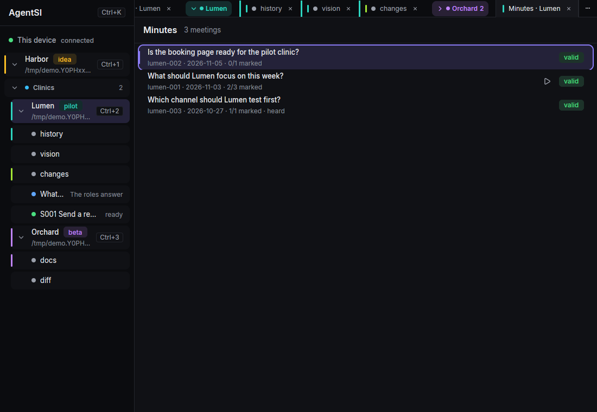

*The Minutes screen. A play mark shows on each row that has a call.*

"Make the call" renders the call with the voices of the core. It takes minutes. The button shows the progress, segment by segment. You need the Kokoro model (see [Voice](#voice)) and `espeak-ng`.

You can also run `agentsi render <minutes-id>`, or add `--audio` to `agentsi meet`.

On the Call screen, `Space` plays or pauses. `Left` and `Right` move between segments. `L` marks the call as listened. A call that plays to its end gets the mark. A click on a segment plays from its start. `Ctrl+Shift+P` opens the call of the open minutes.

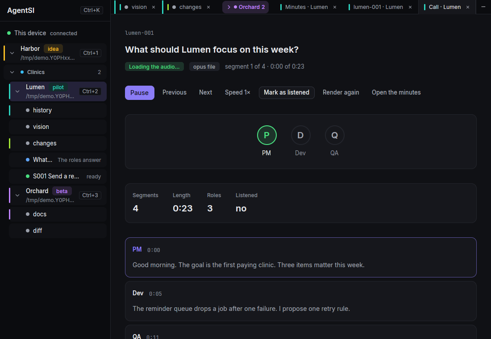

*The Call screen. The circle of the speaking role is lit.*

## Decisions and priorities

The minutes hold two kinds of items that wait for you. A priority waits for your mark. A decision waits for your approval.

### The desk

The front desk lists the pending items of the product: the priorities with no mark and the decisions that wait. A decision shows its text, its reason and its action. Use the buttons Approve, Reject and Archive. On the keyboard, `A` approves, `R` rejects and `X` archives the decision under the cursor. A priority has the buttons Accept, Change, Reject and New, and the keys `A`, `C`, `R` and `N`. `Enter` opens the minutes of the item.

The desk has three more buttons. "Update the index" reads the repos of the product again. "New decision" opens a form with the text, the reason and an optional action. "Show archived" lists the archived decisions, each with Restore.

After you approve a decision that has an action, the button "Run in Claude" opens a Claude pane in the folder of the product with that action. Nothing runs before you click it.

An approved decision can carry an action. The action says what an agent does after your approval. A decision that AgentSI could not apply shows the reason.

### Mark the priorities

On the Priorities tab of one minutes, each priority has the buttons Accept, Change and Reject. A button "New" flags a priority that you did not have in mind.

- Keys: `A` accepts, `C` changes, `R` rejects and `N` flips the "new" flag.
- You can change a mark later.
- The marks feed the reflection. See [Roles learn](#roles-learn).

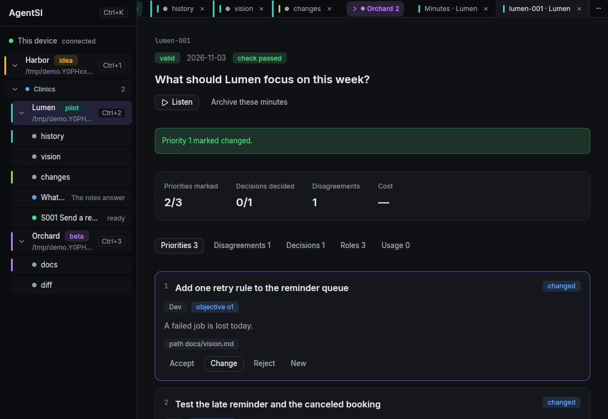

*The Priorities tab. The button of the current mark is filled.*

### From the terminal

```sh
agentsi mark --pending              # list what waits for you
agentsi mark                        # walk through it, one item at a time
agentsi mark <minutes-id> 1 accepted
agentsi decide <decision-id> approve
```

### Archive

Archive hides a minutes, a decision, a story or a product from the lists and counts. It deletes nothing. Bring an item back with Restore: on the desk for a decision, on the story screen for a story, and in the sidebar for a product ("Show archived products"). In a terminal, run `agentsi restore`. To delete data, see [Data](#data).

## Stories

A story is one unit of work with 2 to 5 criteria. After you approve it, a story session builds it in a separate branch. Stories mode is off until a product has a `stories` block in the registry.

```json
"stories": { "test": "node --test {files}", "gate": ["pnpm typecheck", "pnpm lint"] }
```

The story sessions run the `test` and `gate` commands through `sh -c`. Write only commands you trust. Read [SECURITY.md](../../SECURITY.md) before you turn Stories mode on.

### The steps

1. Propose. In the app, use "New story" (a text and a type: Story, Task or "The PM picks") or "Suggest" on the Stories screen. Each asks one Confirm, because the PM calls the model. In a terminal, run `agentsi story new "<text>"`, or `agentsi story suggest`. The PM writes the criteria.
2. Approve with the Approve button, or `agentsi story approve <id>`.
3. Run with `agentsi story run <id>`. QA writes the tests first, and each test must fail. Then the owner role writes the code.
4. Review. The Stories screen shows the diff, the checks and the session log.
5. Accept or reject. Accept merges the branch into the main branch of the product, locally. Reject drops it.

The Stories screen opens with `Ctrl+Shift+S`. A button that changes a story shows what it will do first, and writes after you press Confirm.

The story screen has more buttons. "Request changes" opens a form with a note and the box "The PM rewrites the story". "Record a merge" takes the commit hash and the choice "merged unchanged" or "merged with changes", for a merge that happened outside the app. "Archive" hides the story, and "Restore" brings it back. Archive is off while a session runs.

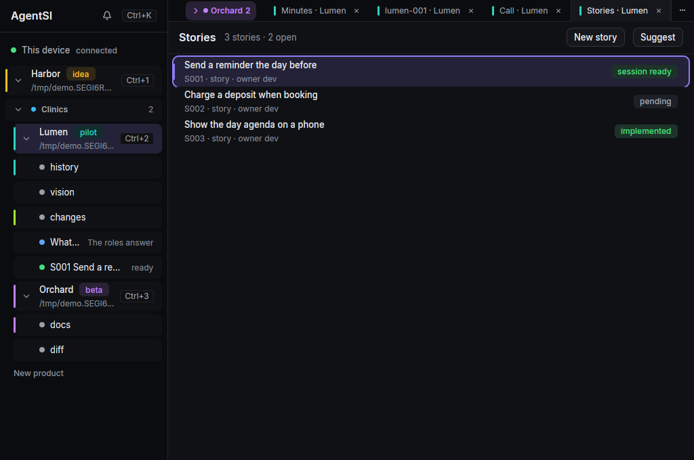

*The Stories screen.*

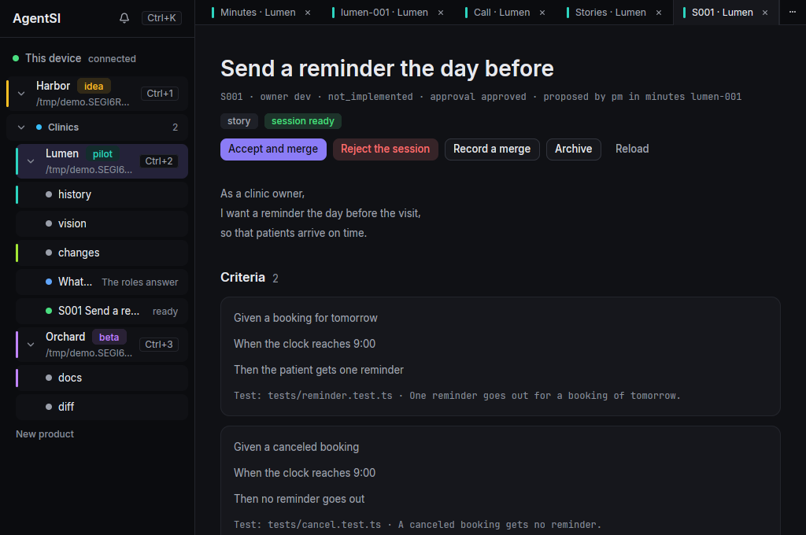

*One story with its criteria, its session and its review actions.*

The steps of a story:

1. The PM proposes a story with `story new` or `story suggest`.
2. You approve it with `story approve`.
3. `story run` makes a worktree and the branch `story/<id>`.
4. QA writes the tests and commits them. Each test must fail.
5. The owner role writes the code, with the tools Edit and Write.
6. The checks run in `bwrap`: the tests and the gate. If a check fails, the owner role gets one more try.
7. When the checks pass, the story is ready. `story review` shows the diff.
8. You accept or reject the result. You can also ask for changes.

*A story, from the idea to the merge. If a check fails, the owner role gets one more try.*

## Roles learn

Each meeting leaves a log: which checks failed, which sources a role invented, and what it cost. Your marks say which priorities helped.

### Reflect

`agentsi reflect` reads the log and the marks. The Memory screen has the same action: the button "Reflect" asks one Confirm, the box "Memory only" skips the prompt proposal, and "Cancel the reflection" stops a run. It adds and retires memory items of each agent. The next meeting uses them. It calls a model, so it costs money.

If a role fails often, the reflection proposes a new prompt. A replay tests the prompt on old meetings. The prompt passes only if no metric gets worse, and it waits for your decision.

The steps of the learning:

1. A meeting records its minutes and its log. You mark the priorities.
2. `agentsi reflect` reads the log and the marks.
3. The reflection curates the memory, which holds items for each agent. The next meeting uses the memory.
4. If a role fails often, the reflection proposes a new prompt. It is an overlay of the role.
5. A replay tests the prompt on old meetings.
6. If the replay passes, the prompt waits for your decision. You approve it with `agentsi decide`.

*How the roles learn.*

### Memory

The Memory screen (`Ctrl+Shift+Y`) shows the items of each agent, newest first. Each item shows how often it helped or hurt.

- Retire an item with `X`. The screen shows the item first and writes after you press Confirm.
- Revert a reflection that changed memory. The screen shows what it undoes first.
- Approve or reject a pending prompt proposal.

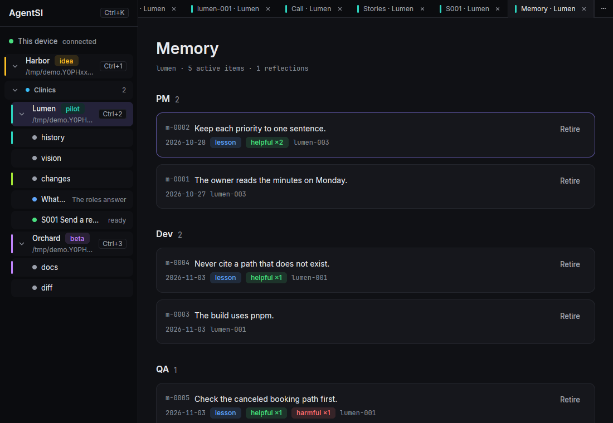

*The Memory screen. Items, reflections and proposals.*

### Brief, roster and audit

- `/agentsi setup` in Claude Code interviews you and writes the brief and the roster of a product.
- The Roles screen shows the roster, the specialists and the overlays. "Update the brief" opens the Setup screen. Validate checks them. "Definition" on a row shows the resolved definition of that agent. The reset plan has a box "Also delete the memory".
- `agentsi roles` prints the roster. `agentsi reset <agent>` returns an agent to the global roles.
- `agentsi audit` checks the config, the meetings, the marks and the memory. It makes no model call.

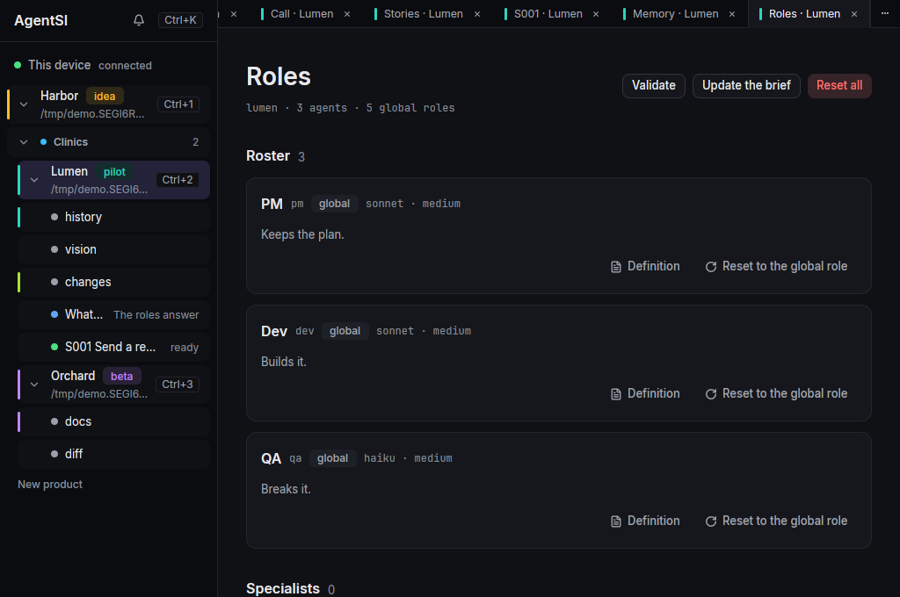

*The Roles screen.*

## Voice

You can dictate into a terminal pane, talk to a Claude session with no hands, and hear the replies. The pill does the listening and the speaking. It runs as its own program, `agentsi-pill`.

### Download the models

Open Settings. The section "Voice models" lists each model with its size, its license and its state. Press Download. Each file has a pinned SHA-256 hash, and a wrong file is deleted.

- Speech in: Parakeet TDT v3. It turns your voice into text on your machine.
- Speech out: Kokoro. It speaks the replies and renders the calls. It needs `espeak-ng`.
- Voice detector: Silero VAD. It finds the end of a turn.

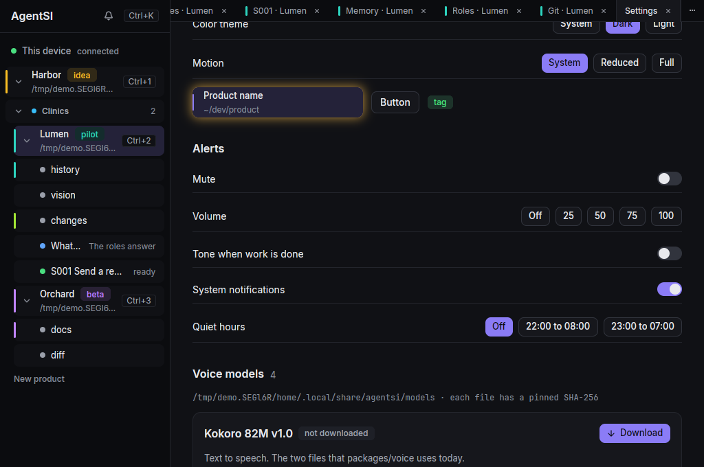

*The voice models in Settings.*

### Dictation

Hold the dictation key and speak. When you release the key, the text goes to the focused pane. With no focused pane, it goes to the clipboard. A recording stops after 120 seconds.

**Toggle dictation** starts on one press of the key and stops on the next press. You speak freely in between, with no time limit. The text arrives in pieces, after each pause of 0.6 seconds. The pill stops by itself after 10 minutes with no speech.

Choose the form in Settings, section "Dictation key", row "Mode". The default is "Hold to dictate". The other is "Press to start, press to stop".

### Conversation mode

Conversation mode lets you talk to one Claude pane with no hands. Each spoken turn goes to the pane. The pill speaks the reply, and then listens again.

- Start it with the palette entry "Talk to this pane", with the menu of a pane, or with the conversation key.
- The target is the pane that has the focus at the start.
- A turn ends after 1.2 seconds of silence.
- Say "stop" or "para" alone to end the mode. A click on the pill, the conversation key and a closed pane also end it. So does a silence of 10 minutes.

The pill shows a small mark when the microphone is open with no key held.

### Voice mode

Voice mode is a switch on one pane. When it is on, the pill speaks the replies of the Claude session in that pane. It speaks only the short text above the line "On screen only".

Turn it on with the switch in the pane header, with `Ctrl+Shift+M`, or with `/agentsi:voice` in Claude Code. Each turn is also saved as a Markdown transcript in the `voice/transcripts/` folder of the data root.

### The vocabulary

No speech model knows the names of your products. The vocabulary fixes them. It is a list of terms, each with the forms that the model hears. The core replaces a heard form with its term in each transcript.

Edit it in Settings, section "Vocabulary", or in `vocabulary.toml` in the config folder. The core seeds it once from your product names.

## Keys

The section "Keys" of the Settings screen lists each action with its key. Press Change, then press the new key. Press Escape to cancel. Press Reset to go back to the default.

The editor refuses a key and says why in these cases:

- the key has no `Ctrl`, `Alt` or `Super` (a function key is fine),
- the key belongs to the pane (`Ctrl+Shift+C` and `Ctrl+Shift+V`),
- the key is `Ctrl` with one letter, which terminal programs read,
- another action has the key. The message names that action.

A new key works at once. The file `keys.toml` in the config folder keeps only the keys that differ from the defaults.

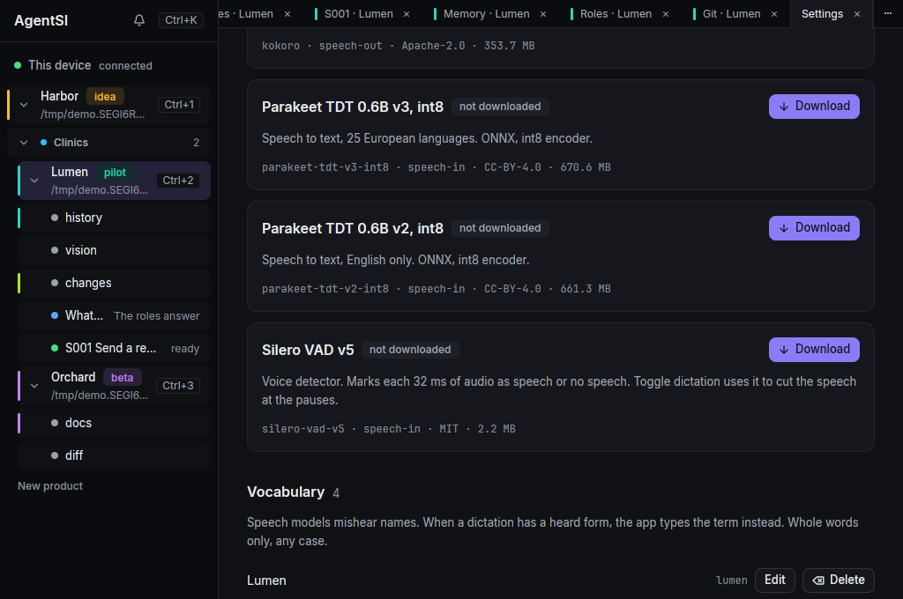

*The section "Keys".*

### The dictation key

A Wayland app cannot read a global key. So the compositor runs one command when you press the key and another when you release it. On Linux, AgentSI supports Hyprland.

AgentSI never edits your Hyprland config. It writes a bind file in its own config folder. You add the include line to your config one time.

1. Open Settings and find the section "Dictation key".
2. Press Change, then press the key.
3. If another bind holds the key, AgentSI refuses it and names that bind.
4. Press Copy on the include line, and add the line to your Hyprland config.
5. When Hyprland holds the bind, the section shows "Active".

After that, a new key needs no hand edit. AgentSI writes the bind file and applies it at once. The section can also show "Add the include line", "The bind file is out of date" or "The key is taken by &lt;bind&gt;". The Remove button writes an empty bind file, so the include line stays valid.

The second row, "Conversation key", starts and stops conversation mode. It uses the same bind file. [CONTRIBUTING.md](../../CONTRIBUTING.md#dictation-key-hyprland) has the lines to write by hand for each form of the Hyprland config.

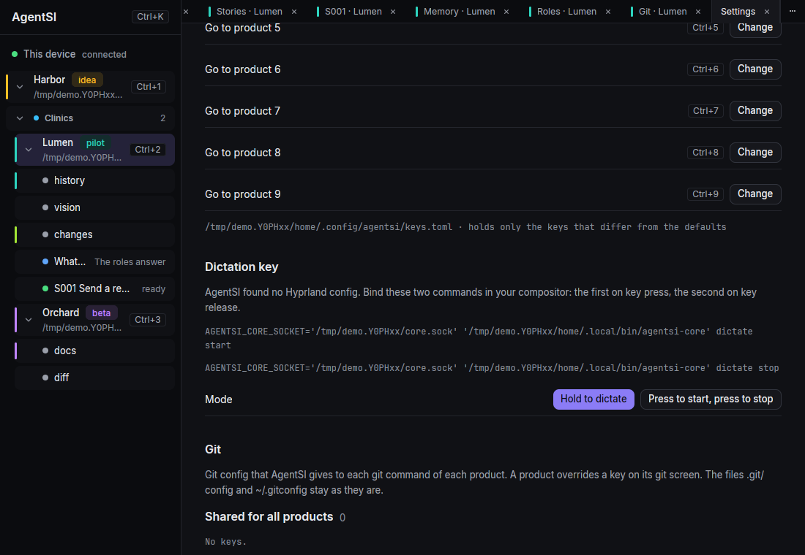

*The section "Dictation key". It shows the include line and its state.*

## Data

The data root is the folder that holds your registry and your data. `AGENTSI_HOME` or `~/.config/agentsi/home` names it. Without either, it is the `data/` folder of the code checkout.

| In the data root | What it holds |
|---|---|
| `agentsi.config.json` | The registry |
| `agentsi.db` | The SQLite file: minutes, marks, decisions, stories, memory and the index |
| `workspace/` | The audio of the calls |
| `voice/` | The transcripts of voice mode |
| `backups/` | The daily backups |

The data root is not a git repo, and AgentSI makes no commits in it. Only the core opens the SQLite file.

The config folder (`~/.config/agentsi`) holds the files of this device: `keys.toml`, the bind file, `vocabulary.toml`, `appearance.toml`, `git.toml`, `look.toml` and `layout.json`.

### Backups

The core makes a backup each day. It writes `backups/agentsi-<date>.db` and a copy of the registry, and it keeps the last 14. Run `agentsi backup` to make one now.

To go back, stop the core. Copy a backup file over `agentsi.db`, and delete `agentsi.db-wal` and `agentsi.db-shm` if they exist. Then start the core.

### Clear data

The section "Data" of the Settings screen deletes what you select. A backup runs first. If the backup fails, nothing is deleted.

| Item | What goes |
|---|---|
| Product | Each row and file of one product, and its registry entry |
| Meetings | The minutes of one product, all or older than a date, with their marks, decisions and calls |
| Stories | The stories of one product that are done or rejected. Worktrees and branches stay |
| Role learning | Memory, overlays, briefs and reflections of one product |
| Call audio | The `audio/` folders. The minutes stay |
| Voice transcripts, Logs, Backups | The files of each kind. Backups keeps the newest |

1. Check the items to delete. Choose a product or a date where the item allows it.
2. Press Review. The screen shows the clear plan: the counts of rows and files, and the bytes.
3. Press Delete and confirm. The screen shows the backup path and any file that could not go.

A product with a running pane, meeting or story session is refused. AgentSI never deletes a repo, a branch, a worktree or a model.

The CLI does the same: `agentsi clear <item> [--product <id>] [--before <date>] [--yes]`. Without `--yes` it prints the plan and deletes nothing.

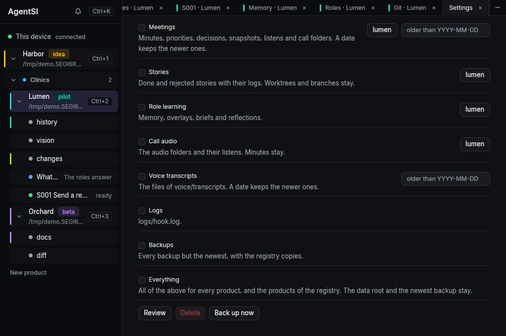

*The section "Data". Review comes before Delete.*

## The CLI and the Claude Code plugin

### The CLI

`agentsi help` lists the commands. Each command is a client of the core. These are the ones you use most:

| Command | What it does |
|---|---|
| `agentsi doctor` | Checks the tools that AgentSI needs |
| `agentsi whoami` | Finds the product of a folder |
| `agentsi desk` | Prints the front desk of a product as JSON |
| `agentsi status` | Prints the state, the pending decisions and the last minutes |
| `agentsi meet` | Runs a meeting. `--audio` renders the call |
| `agentsi ask` | Asks one role one question |
| `agentsi mark`, `agentsi decide` | Mark priorities, approve or reject decisions |
| `agentsi story` | Propose, approve, run and review stories |
| `agentsi reflect` | Curates memory and may propose a prompt change |
| `agentsi roles`, `agentsi reset` | Show the roster, return agents to the global roles |
| `agentsi audit` | Checks the health of a product, with no model call |
| `agentsi render` | Renders the call of a meeting |
| `agentsi archive`, `agentsi restore` | Hide an item from the lists, bring it back |
| `agentsi backup`, `agentsi clear` | Back up the data, delete data |
| `agentsi voice` | Turns voice mode on or off |
| `agentsi web` | Opens the desktop app |
| `agentsi mcp` | Runs the MCP server on stdio |

### The Claude Code plugin

Run `/agentsi` in a product repo. The PM greets you with the state of the product, the pending decisions and the last minutes. From there you can ask, convene a meeting, consult one role, mark, decide and manage stories.

- `/agentsi setup` writes the brief and the roster.
- `/agentsi audit`, `/agentsi roles`, `/agentsi reset` and `/agentsi reflect` run the matching commands.
- `/agentsi:voice` turns voice mode on or off for the session.

The plugin also gives Claude Code the roles as subagents and the `agentsi` MCP server. The server has the tools `search`, `get_doc`, `list_minutes`, `pending_decisions` and `role_memory`.

A hook asks before each `git push` and `gh pr create` while the plugin is on. It is a prompt, not a security boundary. To turn it off, run `claude plugin disable agentsi@agentsi`.

After you change a global role, update the plugin copy with `claude plugin marketplace update agentsi` and `claude plugin update agentsi@agentsi`.

---

Next: the [README](../../README.md) for the project, [CONTRIBUTING.md](../../CONTRIBUTING.md) to build and test, and [CONTEXT.md](../../CONTEXT.md) for the terms.
